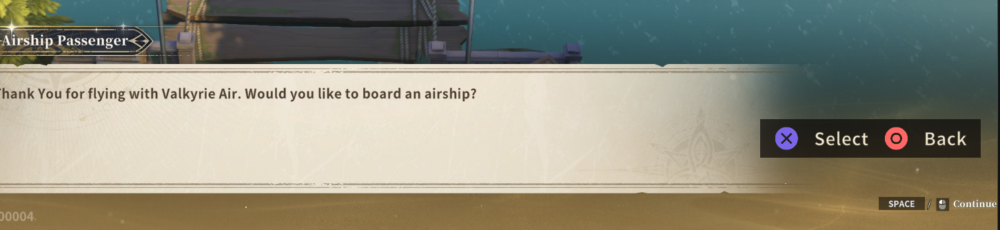

# Controller roadmap

Goal: the controller is **the** way to play this offline RO3. From launch to logout, nothing needs a mouse or a
keyboard: login, server and character select, character creation, every in-game screen, chat and settings. Every
prompt shows the right button glyph. The controller UI is our own, Diablo-style: compact, readable at 1080p and 4K,
built for a couch distance. It is a remake, not a reskin of the mobile UI.

Status legend as in [ROADMAP.md](../../../ROADMAP.md): `[x]` done and verified in game, `[ ] 🔄` in progress, `[ ]`
not started, `❓` needs investigation. Tick an item only after it works in game.

## Handoff for the next agent (2026-10-15, updated)

**State.** Phase 0 (pad works on the stock UI) is done and verified: pad-only login without passwords, character
select, tutorial guide, bag/equip navigation, tabs, item use, on-screen keyboard, PS5 glyphs on stock key labels.
Phase 2 has a first prototype, all verified in game:
- **Controller HUD v1** (`ControllerHud.cs`, `3bb7fa7`): HP/SP orbs, bound skills (icons, cooldowns, glyphs), D-pad
  potions with counts, on a plate. The stock bars are hidden but keep running as the data source, and contextual stock
  widgets (buffs, auto-potion...) are lifted above it.
- **Radial menu** (`Wheel.cs`, `91b84cf`): tap Create/View. Entries run the game's own input actions through
  InputSystemManager's private handlers. Cursor mode is now a 0.5 s hold on the same button.
- **Context interaction** (`Interact.cs`, `f566b40`, verified by the player): ✕ Talk / Pick up / Gather on the nearest
  unit, sending the same click as the mouse (`MyInput.Obf_xj`).

It is a **barebones prototype**: the player wants it polished and then skinned with assets they draw themselves (see
the two sections below). The player asked for a full remake, no shortcuts, and for **reusing the game's own UI wherever
it exists** (see "How it is built").

**Code** (all in `src/Ro3Emu.ClientHooks`):
- `Controller.cs`: bindings on the game's Input System actions, camera, virtual cursor, wheel button, mode-select
  hooks, own per-frame button edges.
- `ControllerIni.cs`: defaults and parser, tested.
- `UiNav.cs`: menu navigation and guide mode.
- `Osk.cs`: on-screen keyboard.
- `Overlay.cs`: our canvas, prompt bar, `Overlay.Scale`.
- `Glyphs.cs`: PS5 sprites by control path; stock key labels -> glyphs.
- `ControllerHud.cs`: HUD, plus `Shapes` (procedural sprites).
- `Wheel.cs`: radial menu, plus `Wheel.Run(action)`, which runs any game action.
- `Interact.cs`: context interaction.
- `Diagnostics.cs`: dev commands.
- `UiTweaks.cs`: mode-select relabel, password row hidden.
- Server: `RequirePasswords` (off in appsettings).

**Dev loop (use it; do not ask the player to restart or press buttons):**
1. Build: `RO3_CLIENT_DIR="$PWD/../RO3 Launcher/Client" dotnet build src/Ro3Emu.ClientHooks` (toolchain in CLAUDE.md).
2. `tools/linux/dev/restart-client.sh` installs the DLL (atomic rename), restarts the client and waits for the login panel. It sets `RO3EMU_FORCE_CONTROLLER=1` (Wine passes host env
   through umu-run), which forces controller mode for that session only; the saved `ro3emu.controller` is untouched.
3. `cat tools/linux/dev/to-world.txt more-commands.txt | tools/linux/dev/cmd.sh` reaches the world by virtual pad.
4. Commands, one per line, run one per frame:
   - `focus ignore` (send first: input works while the window is in the background), `verbose`.
   - `pad <GamepadButton>` (South/East/West/North/DpadUp/LeftShoulder/LeftTrigger/RightStick/Start/Select...) presses a
     button on a virtual `Ro3emuTestPad`; the real DualSense overwrites injected states. `stick <x> <y> <frames>` holds
     the left stick (walk). `key <Key>`.
   - `wait <frames>`, `waitmenu <part of panel name> [seconds]`, `select <object name>`.
   - `shot <name>` -> `<client>/ro3emu/shot-<name>.png`; `tree <object> [depth]` -> `ro3emu/tree.txt`;
     `pick <x> <y>` lists the UI under a screenshot pixel.
   - `click <object name>`: pointer click (as UiNav sends it) on the first active object of that name; for mouse-only widgets.
   - `find`, `panels`, `actions` (real Input System action names), `lua`, `luacall`.
   - Log: `~/.local/share/ro3emu/prefix/drive_c/users/steamuser/AppData/LocalLow/gravity/ro3/Player.log`.
5. GM warp over loopback: `curl -X POST "http://127.0.0.1:5380/ro3emu/gm?account=featureJosh" --data '!warp 10101 155 55'`.
   10101 155 55 is the Prontera bridge, by the NPC "Person Resting"; 10111 150 190 is a field with Fabre monsters.
6. Read the screenshots. When server code changes, restart the server with `start-server.sh
   --Ro3Emu:Population:Enabled=true --Ro3Emu:Population:PerMap=50 --Ro3Emu:Population:MaxTotal=50`.

**Gotchas learned.**
- Use Input System action names (`ClosePanel`, `InteractiveSkill_01`), not Lua `enum_InputKey` keys.
- Item cells (`UIDragButton`) and many links (`ClickEvent`) are plain click handlers, not Selectables.
- Key labels are `InputBinder` (`m_inputKey`, `m_tip`, `m_view`), often inside a layout-group badge.
- The guide panel blocks Esc and hotkeys.
- `UiTweaks.Tick` can be pumped more than once a frame (guarded).
- `CP_ColliderBase.m_bIsLocalPlayer` is never set; the player's position is `WS_WorldStreamProxy.Obf_fbA()`.
- Colliders are pooled, so re-resolve them at use.
- Commit only explicit paths.

**Next goals, in order:**
1. **HUD polish** (checklist below, player feedback).
2. **Reuse stock UI**: the stock prompts take our glyphs, and our duplicates are dropped (see below).
3. **Targeting:** soft lock / R1 cycle with a target frame (the stock `UI_Sys_Main_TargetAvatarInfoWidget_PC` already
   shows one: reuse it).
4. **Controller settings page:** in-game remap writing `controller.ini`, glyph style, UiScale/GlyphScale, sensitivity.
5. **Art pass** with the player's assets (section below): build the skin loader early, so the player can start drawing.
6. **Phase 3 rebuilt menus** in usage order (inventory with paper doll first).
7. **Open issues:** the Options glyph reads poorly; camera speed/sign unverified; L3 OpenMap and other defaults
   unreviewed; English text/grammar pass (separate roadmap item).

**2026-10-15 implementation update (not yet checked in game).** The controller hook now builds with a live PNG skin
loader for HUD, wheel, prompts, glyphs, and keyboard art. The [art handoff](controller-art.md) and drawing template
list supported file names and sizes. The radial menu now opens a Controller page that shows enabled game actions,
rebinding, conflict warnings, and editable UI scale, glyph scale, camera speed, cursor speed, and dead zone. Both
features still need a live client pass at 1080p and 4K. The remaining targeting, skill layers, rebuilt menus, and
full play-session items below are still open.
Cooldown-ready flash and low-HP orb pulse now build from the stock HUD state; their timing and look need that pass too.

## HUD polish (player feedback 2026-10-15)

- [ ] **Glyph legibility:** glyphs have no background, so on a skill icon of the same colour they are hard to read.
  Switch to glyph art with a built-in stroke/outline (Kenney Input Prompts' outline variants, or another CC0 set) rather
  than drawing outlines in code or detecting pixel colours.
- [ ] **Glyph size:** a little smaller everywhere (`GlyphScale` default and the HUD/slot glyph sizes).
- [ ] **Prompt bar** (control guide, lower right): too big; shrink it.
- [ ] **HUD size:** the Diablo-style HUD is a bit too big overall; lower its base size (still times `Overlay.Scale` / `UiScale`).
- [ ] **Feedback animations:** using □ or an item gives no visual response. Add a press animation (scale punch, flash) on
  skill and potion slots when used, and on wheel entries.
- [ ] **Cooldown display** does not show properly: the radial sweep and seconds are unreliable. Check against the stock
  slot's state (`Mask_Img` / `BarTime_Img` fill / `Time_TTxt`; potions `CD_RTransform` / `CD_Img`) and fix.
- [ ] **Stock prompts instead of our prompt bar:** the game already draws prompts. The NPC dialog shows
  "SPACE / [mouse] Continue" in its bottom-right corner, while our bar draws a second, redundant "✕ Select ○ Back" on top:

  

  Find the widget that draws it (`tree` on `UI_Sys_NpcDialogPanel`), give it our glyph and text (it is likely an
  InputBinder-style label, which `Glyphs.cs` already handles), and hide our bar on screens that have their own prompts.

## Art pass: custom assets (drawn by the player)

The current look is procedural placeholders (`Shapes`: circles, rings, rounded squares). The player will draw the real
assets. Plan:
- [ ] **Skin loader:** PNGs dropped into `<client>/ro3emu/skin/` override the procedural shapes by file name, without a
  rebuild (re-read on change like `controller.ini`). A missing file falls back to the placeholder; log which names were
  found. Loader is built but unverified in game; optional `skin.ini` for 9-slice borders and tints remains open.
- [ ] **Asset list with sizes** (PNG with alpha). Draw at 4K, i.e. 2x the 1080p numbers below; the loader scales.
  Frames are 9-slice where noted.
  - HUD: `orb_frame` (300x300), `orb_glass` (shine, 300x300), `orb_fill_hp` / `orb_fill_sp` (276x276; liquid,
    optionally tileable for a wave scroll), `plate` (9-slice, about 120 high), `plate_edge`.
  - Slots: `slot_frame` normal / pressed / disabled / ready-flash (156x156), `slot_cooldown_mask` (156x156),
    `potion_frame` (116x116).
  - Radial menu: `wheel_disc` (1000x1000), `wheel_ring`, `wheel_slice` normal / selected (9-slice), optional per-entry
    icons (`wheel_bag`, `wheel_map`, ... 96x96).
  - Navigation: `focus_ring` (9-slice), `prompt_bar` (9-slice), `interact_prompt` (9-slice), `osk_key` normal / focused
    (9-slice).
  - Glyphs: optional own glyph set by control name (`glyph_buttonSouth.png`, ...), overriding Kenney's.
  - Font: optional TMP font (the game's font is used today).
- [ ] **Animation hooks** for the art: press punch, cooldown-ready flash, low-HP pulse on the orb, wheel open/close.
- [ ] Write the art spec as its own doc (`docs/roadmap/controller-art.md`) with a template sheet the player can draw on.
  Draft and SVG template exist; review with the player's PNGs before checking this item off.

## How it is built

**Principle (player, 2026-10-15): reuse the game's own UI first.** Prefer the game's widgets, prompts, panels and
animations; add our own UI only where nothing exists. Review the existing overlay pieces (prompt bar, focus ring, wheel,
HUD) against stock equivalents: e.g. stock key-hint widgets for prompts, the stock target frame, stock tooltips.

- **Code:** client hooks (`src/Ro3Emu.ClientHooks`), C# loaded into the client. The signed Lua cannot be changed, so
  the hooks replace Lua table functions with C# delegates (see `LuaPatches`, `Controller`) and build Unity UI from C#.
- **Input:** the game's own Input System actions (`RO3Current`, `RO3_Fixed`; `enum_InputKey`) carry gamepad
  bindings, so game logic sees the same events as from the keyboard. Our own controller actions (cursor, camera,
  navigation, radial menus) are read directly from the gamepad.
- **UI:** one overlay canvas of our own (`ScreenSpaceOverlay`, `CanvasScaler` scale-with-screen from 1920x1080, plus a
  user **UI scale**), drawn above the game's UI. Data comes from the game: the stock widgets keep running hidden
  (alpha 0, no raycasts) and we read their icons, fills and texts, or we call the Lua helpers they use. Where a screen is
  rebuilt, the stock panel stays closed or hidden and our screen calls the same Lua actions.
- **Navigation everywhere:** a focus system that works on any stock panel without per-panel code: it finds the
  clickable elements of the top panel, moves focus spatially with the D-pad / left stick, clicks with ✕, closes with ○,
  scrolls scroll views with the right stick and switches tabs with L1/R1. Rebuilt screens use the same system.
  Per-panel rules (order, skips, default focus) are data, not code.
- **Glyphs:** PS5 set (Kenney Input Prompts, CC0, `Glyphs/`, named after Input System controls). Xbox set to add.
  Glyph style follows the setting, or the connected pad (auto).
- **Dev loop:** `<client>/ro3emu/cmd.txt` (`tree`, `shot`, `panels`, `find`, `dumptex`), hierarchy in
  `ro3emu/tree.txt`, screenshots in `ro3emu/shot.png`. Every screen is checked by screenshot at 1080p and 4K.

## Phase 0: foundation

- [x] Gamepad bindings on the game's actions, live-reloaded `ro3emu/controller.ini` (`08e9a98`).
- [x] Controller mode in Select Mode (relabelled Mobile column) saves Modern PC + controller flag (`810d1ce`,
  `bc00967`; the mobile-UI fallback fixed, re-check after restart).
- [x] PS5 glyph set embedded; dev command file (`9a5bcf4`).
- [x] Controller card uses its own mode value 4; no mobile HUD on re-pick (`79e753e`, verified by the player).
- [x] Glyphs replace stock key labels (`InputBinder`) in controller mode (`79e753e`, verified by the player: shown, but
  too small to read the shapes at the label size).
- [ ] 🔄 `GlyphScale` (default 2.4x, live) plus a 34 px floor: 2.4x was still ~14 px on the skill bar (screenshot).
- [ ] 🔄 HUD inventory: dump the PC HUD widgets (skill bar, HP/SP, buffs, minimap, quest tracker, chat, team, target).
- [ ] 🔄 Overlay canvas + UI scale (`353bc6f`); theme (frame, fonts from the game's TMP assets, colours); glyph component that follows
  bindings and glyph style.
- [x] Login, character select and world entry with the pad only (player, 2026-10-14; `353bc6f`).
- [x] Menus verified by scripted run: login, character select (cards), bag + equip windows (item cells via UIDragButton), ○ Back closes the top window.
- [x] Cross-window focus (45° cone), L1/R1 tabs incl. the game's ClickEvent tabs, item tooltip -> Use (potion used,
  cooldown shown), focus returns to the item after the popup (`0511532`, `9d586a8`, scripted runs).
- [ ] 🔄 Navigation core: focus scan of the top panel (stock buttons, toggles, sliders, dropdowns, input fields, scroll
  views), spatial moves, focus ring, ✕ click / ○ back / L1 R1 tabs / R-stick scroll, hold-to-repeat.
- [x] Glyph size readable on the skill bar (`36ca586`, player: "bigger now, too big"); tune size later.
- [x] Start / ✕ interact bound: the ini must use Input System action names (`ClosePanel`, `InteractiveSkill_01`,
  `ExpandSkill_01`), not Lua `enum_InputKey` keys (`Esc`, `Interactive_1`); `actions` dev command lists them.
- [x] Tutorial guide with the pad: ring on the hole, ✕ clicks through (`13708ba`, verified by scripted run).
- [ ] (was) Tutorial guide: its mask only passes clicks inside the highlighted hole, so it soft-locks a pad player and
  blocks Esc ("ESC action blocked by: Guide") and panel keys. Guide mode: ring on the hole, ✕ clicks through.
- [ ] Glyphs too large in places now (player); per-context size.
- [ ] Prompt bar on every screen (✕ Select, ○ Back, △/□ per screen), built from what the focused screen supports.
- [ ] Device detection: controller connected / disconnected, "press any button" wake, keyboard and mouse still work
  side by side; glyphs switch to keyboard when the keyboard is used.
- [ ] Rumble (hit taken, level up, MVP), DualSense lightbar from HP (optional, settings).

## Phase 1: from launch to the world, without a keyboard

- [x] Login without keyboard/mouse: no password (server `RequirePasswords` off, row hidden), focus starts on Start Game; on-screen keyboard for text fields (`c2d26fa`, `d248ad9`, scripted run).
- [ ] Login screen polish: focusable account field, on-screen keyboard (✕ type, □ delete, △ space, L1/R1 move cursor,
  OPTIONS done), remember last account, ✕ to log in. Any account works on our server.
- [ ] On-screen keyboard component, reused by chat, naming, search, mail, stall titles.
- [ ] Server list, notices, agreements and pop-ups: navigable, ✕ / ○.
- [ ] Character select: L/R to change character, ✕ enter, △ create, □ delete with hold-to-confirm.
- [ ] Character creation: job, gender, appearance sliders and lists, name with the on-screen keyboard.
- [ ] First Select Mode on world entry: defaults to Controller when a pad is connected.
- [ ] Loading screens and cut-scenes: skip with ✕ / OPTIONS where the game allows it.

## Phase 2: in the world (Diablo-style HUD)

- [x] Prototype v1 of the bar below (`3bb7fa7`, screenshots): orbs, bound skills with glyphs and cooldowns, D-pad potions. Polish: see HUD polish.
- [ ] Bottom-centre action bar: HP orb (left), SP orb (right), six skill slots on ✕ ○ □ △ / L1+, R1+ layers with
  icons, cooldowns, charges and SP-cost dimming; potions and shortcut items on the D-pad; EXP bar.
- [x] Hide the stock skill bar and potion bar while Controller mode is on (kept running as data source; `3bb7fa7`).
- [x] Skill layers: hold L2 / R2 for a second bar (12+ skills without menus), configurable (`ControllerLayers.cs`; code done, **needs a live check**, see below).
  Defaults: L2 + ○ NormalSkill_06, L2 + □ NormalSkill_04, L2 + △ NormalSkill_05, L2 + ✕ ExpandSkill_01, L2 + L1 ExpandSkill_02; R2 + □ InteractiveSkill_02, R2 + △ InteractiveSkill_03, R2 + ○ GamePlaySkill_01, R2 + ✕ GamePlaySkill_02, R2 + L1 GamePlaySkill_03; L2 + D-pad left/right ShortCut_3/4, R2 + D-pad left/right ShortCut_5/6. **Moved:** NormalSkill_04 / 05 were on L2 / R2 (now the layer shifts, `LayerShift2/3`) and are Layer2 □ / △; an existing controller.ini is migrated on load (the two trigger lines dropped, the Layer block appended). ✕/○ talk and pick-up prompts are off while a shift is held. Settings page: Layer2.* / Layer3.* rows (D-pad left/right picks the action, △ resets). ExpandSkill_03..06 exist in the client (Lua_GameDefine.lua) and can be put on a slot in the ini.
- [ ] Targeting: soft lock on the nearest enemy in the stick direction, R1 cycle, R3 lock, target frame with HP and
  casting bar, ally targeting for heals and buffs (L1 + face button or a toggle).
- [ ] Ground-target skills: aim reticle on the right stick, ✕ confirm, ○ cancel.
- [ ] Analog movement (stick angle and magnitude instead of 8 WASD directions), auto-run toggle.
- [x] Context prompt v1: ✕ Talk / Pick up / Gather on the nearest unit (`f566b40`, player verified).
- [ ] Context prompt: talk to NPC, pick up item, open chest, use portal / Kafra, revive, mount (✕ label changes with
  what is in front of you).
- [ ] Loot: pick up nearest / all, item-name popups with rarity colours.
- [ ] Compact quest tracker (one main quest, objectives, auto-path with a button), minimap with zoom on the D-pad
  layer, buffs/debuffs row, party frames.
- [x] Radial menu v1 on Create/View: bag, character, skills, quests, map, friends, guild, shop, auto battle, settings (`91b84cf`, screenshot: opened the bag).
- [ ] Radial menus: TOUCHPAD / CREATE opens the menu wheel (bag, equip, skills, character, map, quests, guild, friends,
  mail, shop, settings); hold D-pad for consumables and emotes.
- [ ] Combat feedback: damage numbers sized for 4K, low-HP vignette, rumble.
- [ ] Death / revive panel, level-up and job-change notices.

## Phase 3: menus rebuilt for the controller

Each rebuilt screen: full-screen or side-panel layout, focus navigation, tabs on L1/R1, prompts, sorting / filtering on
△ / □, item comparison on R3, tooltips that follow focus. Order by how often players use them.

- [ ] Inventory and equipment (paper doll, compare, equip / use / drop / split, cards, refine entry points).
- [ ] Skills (tree, learn points, assign to the controller bar by button press, skill plans).
- [ ] Character (stats, allocate points, titles, appearance).
- [ ] NPC dialog and choices (D-pad, ✕; dialog advance on ✕), quest log, quest rewards.
- [ ] World map and teleport (cursor on the map, waypoints, auto-path).
- [ ] Shops, Kafra storage, trade, stalls, mail.
- [ ] Settings, including a **Controller** page: remap every action in game (press to bind, conflict warning,
  reset), stick sensitivity / inversion / dead zones, glyph style (PS5 / Xbox / auto), UI scale, HUD layout, vibration,
  aim assist. Writes `controller.ini`.
- [ ] Chat: channel tabs, quick-chat wheel, on-screen keyboard; read-only mode by default.
- [ ] Party, guild, friends, mail lists.
- [ ] Pets, cards, totems, mounts, wardrobe, collection, achievements, activities, season, rankings: navigation layer
  first, rebuilt by usage.
- [ ] Mini-games (music game, chicken, dungeons with special HUDs): controls mapped and prompts shown.

## Phase 4: polish

- [ ] Everything audited: a full play session (launch, create, tutorial, combat, shop, party with bots, logout) with
  the keyboard and mouse unplugged.
- [ ] 4K and 1080p screenshot pass for every rebuilt screen; ultrawide.
- [ ] Steam Deck / Steam Input check (glyphs, on-screen keyboard vs Steam's).
- [ ] Performance: HUD updates at most once a frame without allocations; no hitches when screens open.
- [ ] Translation: all our strings through the English text layer.

## Known gaps and risks

- ❓ Which components the stock UI uses for buttons (Lua `UIButtonNew` etc.) and whether the focus scan can click them
  through `ExecuteEvents` or needs their Lua `SetOnClick` callbacks. First tree dump answers it.
- ❓ Whether the game's EventSystem module accepts our navigation events (legacy StandaloneInputModule assumed).
- ❓ Text input: TMP input fields focused from C# and filled by our keyboard, also on the login screen (before Lua's
  world modules load).
- Hundreds of stock panels: until rebuilt, each must at least be fully navigable (phase 0 navigation core).
